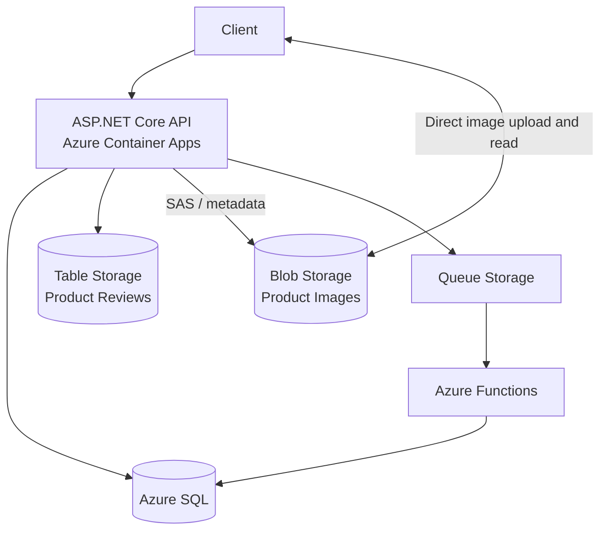

# Online Store Cloud Databases POC

## 1. Project Overview

This project is an ASP.NET Core online store POC deployed with Azure Container
Apps and Azure Functions. It uses Azure SQL, Blob Storage, Table Storage, and
Queue Storage.

The solution is divided into `Domain`, `Application`, `Persistence`,
`ExternalServices`, `API`, and `Functions` layers.

## 2. Storage Architecture

### Azure SQL

Azure SQL stores products, customers, orders, order items, product-image
metadata, and processed-message records. These features require relational
constraints, transactions, and consistent updates such as atomic order and
stock changes.

### Blob Storage

Blob Storage contains the product image files. Blobs use this naming strategy:

```text
{productPublicId}/{imagePublicId}
```

The API issues a short-lived SAS URL so clients upload image bytes directly to
Blob Storage. Image metadata is confirmed separately through the API.

### Table Storage

Table Storage contains anonymous product reviews:

```text
PartitionKey = ProductPublicId
RowKey       = ReviewPublicId
```

Partitioning by product matches the main access pattern: retrieving the reviews
for one product. Review lists use Table Storage continuation-token pagination.

### Queue Storage

Queue Storage buffers asynchronous order creation and status changes:

```text
API → Queue Storage → Azure Function → Azure SQL
```

This allows the API to accept order writes quickly and absorb traffic peaks.

## 3. CQRS and Azure Functions

Commands and queries are separate application operations. `IRequestSender`
acts as the mediator and dispatches each request to its registered handler.

`CreateOrderFunction` processes order creation, while `UpdateOrderFunction`
processes explicit process, ship, and cancel actions. Queue messages include a
`MessageId`; the SQL `ProcessedMessages` table prevents the same message from
being applied twice. The processed-message record and the corresponding order
change are committed in the same SQL transaction.

## 4. Scalability and Partitioning

- Table Storage reviews are partitioned by `ProductPublicId`.
- Queue Storage buffers order-write spikes.
- Azure SQL uses one database for this POC.

SQL sharding is not implemented because the current POC does not require it.
Horizontal SQL partitioning could be introduced later if throughput required it.

## 5. Azure Resource Sizing

The resources are intentionally small for this POC:

- Container App: 0.5 vCPU, 1 GiB, 0–2 replicas.
- Functions: Flex Consumption, 2,048 MB instances.
- Azure SQL: General Purpose Serverless, 0.5–2 vCores, auto-pause enabled.

The `dev` and `prod` parameter files intentionally use the same low-cost
configuration for this POC. Despite the environment name, the current `prod`
deployment is not production-grade sizing. A real production deployment would
normally keep at least one API replica running and use provisioned Azure SQL
compute, or otherwise disable auto-pause, based on its availability and latency
requirements.

The Container App can scale to zero and Azure SQL can pause after being idle.
Consequently, the first API request after an idle period can take noticeably
longer while the application and database start. Allow extra time or retry the
request before treating it as a failure.

## 6. POC / Production Notes

Blob Storage CORS currently uses `allowedOrigins = *`. Production should limit
this to the frontend domain. Public product-image reads are intentional because
the images are public website assets. Shared Key access is enabled where needed
to generate upload SAS URLs.

## 7. Main API Features

- Products: CRUD, pagination, and multiple images with primary-image selection.
- Customers: create, get, and partial update.
- Reviews: create, continuation-token list, and delete.
- Orders: asynchronous create, process, ship, and cancel operations.

All routes are versioned under `/api/v1`. Example requests are available in
`src/OnlineStore.API/http/OnlineStore.API.http`.

## 8. Local Setup

Start SQL Server and Azurite, then configure API secrets from the repository
root:

```powershell
dotnet user-secrets set "Database:ConnectionString" `
  "Server=.\SQLEXPRESS;Database=OnlineStore;Trusted_Connection=True;TrustServerCertificate=True;MultipleActiveResultSets=True" `
  --project src/OnlineStore.API

dotnet user-secrets set "Queues:ConnectionString" "UseDevelopmentStorage=true" `
  --project src/OnlineStore.API

dotnet user-secrets set "ProductImages:ConnectionString" "UseDevelopmentStorage=true" `
  --project src/OnlineStore.API

dotnet user-secrets set "ProductReviews:ConnectionString" "UseDevelopmentStorage=true" `
  --project src/OnlineStore.API
```

Create an ignored `src/OnlineStore.Functions/local.settings.json`:

```json
{
  "IsEncrypted": false,
  "Values": {
    "AzureWebJobsStorage": "UseDevelopmentStorage=true",
    "FUNCTIONS_WORKER_RUNTIME": "dotnet-isolated",
    "Queues:ConnectionString": "UseDevelopmentStorage=true",
    "Queues:CreateOrderQueueName": "order-create",
    "Queues:OrderUpdateQueueName": "order-update",
    "Database:ConnectionString": "Server=.\\SQLEXPRESS;Database=OnlineStore;Trusted_Connection=True;TrustServerCertificate=True;MultipleActiveResultSets=True"
  }
}
```

Apply migrations and run the projects:

```powershell
dotnet ef database update `
  --project src/OnlineStore.Persistence `
  --startup-project src/OnlineStore.API `
  -- --environment Development

dotnet run --project src/OnlineStore.API
dotnet run --project src/OnlineStore.Functions
dotnet test tests/OnlineStore.Application.UnitTests
```

## 9. Azure Deployment

Bicep and GitHub Actions deploy the Container App, Function App, Azure SQL
database, and Storage Account with its Blob container, Table, and Queues. Pull
requests run build, test, security, container, and Bicep validation. Pushes to
`develop` deploy `dev`; pushes to `main` deploy `prod`.

## 10. Architecture Diagram


